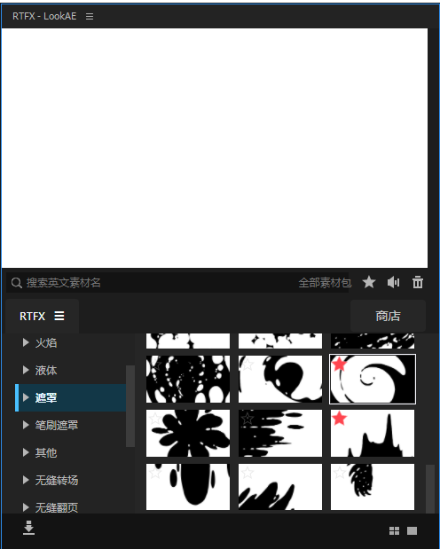

# RTFX 汉化与界面增强补丁

适用于 Windows 上对应版本的 RTFX Generator v2.8.1 CEP 扩展。



## 功能

- 面板汉化：主分类、子分类、商店、收藏和常用提示中文显示。
- 分类高亮：选中分类显示深蓝底色、蓝色左侧标记和加粗文字，移开鼠标仍保持。
- 红色收藏：素材已收藏的星标和顶部收藏夹激活按钮显示红色。
- 保持原版名称：不改素材名称，缩略图下方不增加文字，不介入导入或撤销处理。

## 下载与安装

1. 先安装原版 RTFX，确认面板可正常使用。
2. 点击本页面 Code → Download ZIP，解压全部文件，不要只下载 CMD。
3. 保存工程并关闭 After Effects。
4. 右键「安装补丁.cmd」，选择「以管理员身份运行」。
5. 看到成功提示后，重启 AE 并打开原来的 RTFX 面板。

默认扩展目录：

```text
C:\Program Files (x86)\Common Files\Adobe\CEP\extensions\RTFX extension
```

安装程序会校验原版脚本版本，不匹配时停止安装。请保持 payload 文件夹及其内容与安装脚本放在一起。

## 从旧版升级

直接运行本版安装脚本，无需把旧版补丁逐个还原。重启 AE 后旧版名称简化及撤销处理不再加载。已经保存在工程里的短名称不会自动恢复。

## 还原

保存工程并关闭 AE，右键「还原原版.cmd」→「以管理员身份运行」，完成后重启 AE。

首次安装的原始入口备份为 index.html.rtfx-zh-v1.bak，请不要删除。还原恢复原始入口，停止加载补丁，补丁资源文件会保留但不再被引用。

## 自定义扩展路径

在管理员 PowerShell 中进入补丁目录后执行：

```powershell
powershell.exe -NoProfile -ExecutionPolicy Bypass -File ".\安装.ps1" -ExtensionPath "D:\你的目录\RTFX extension"
```

还原时增加 -Restore 参数。

## 文件

- 安装补丁.cmd：安装或覆盖升级
- 还原原版.cmd：恢复原始入口
- 安装.ps1：共用安装和还原脚本
- payload/rtfx-zh.js：汉化与分类选择逻辑
- payload/rtfx-zh.css：高亮与收藏样式
- preview.png：用户提供的实际预览图

## 说明

只提供补丁，不包含原插件、素材包和授权文件，请自行准备原版。汉化范围为面板；素材文件名、预览里的英文和编译在 JSXBIN 中的 AE 原生对话框保持不变。搜索仍按英文素材名称。
